# tern-grafana

**Tern Grafana** brings Grafana and Prometheus-compatible backends into
[Tern](https://stencil.so/tern) as native blocks: PromQL queries, dashboards,
alerts, silences, logs and server health, next to the commands that changed
them. Panels Tern cannot draw fall back to Grafana's own renderer, then to a
browser pane.

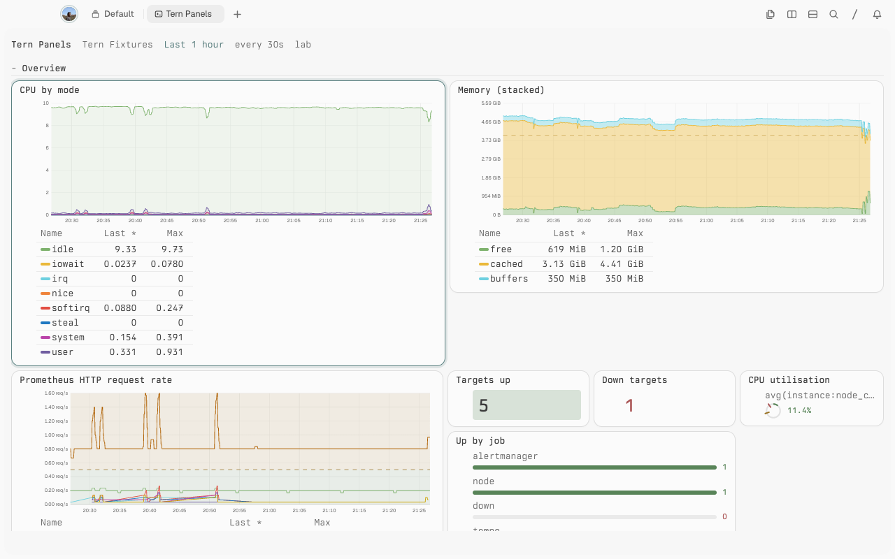

> Pre-release, in active development. See [Features](#features) for what is done and what is planned.

- **Query** PromQL with metric and label autocomplete; read values under a
  keyboard cursor; switch graph and table.
- **Open a Grafana link** (`/d/`, `/d-solo/`, `/explore`, alert pages) and get
  the native block instead of a browser.
- **Triage alerts** from Grafana unified alerting, Alertmanager or Prometheus;
  firing counts in the status line.
- **Silence an alert** prefilled from its labels, with a preview of what it
  covers. Nothing is written until you confirm.
- **Tail Loki logs** with level colors, volume bars and one-click label filters.
- **Check a Prometheus server**: scrape targets, cardinality, build and flags.
- `promtool`, `amtool`, `logcli` and `curl` output renders natively.
- **Annotate deploys** you run in Tern (`helm upgrade`, `kubectl apply`,
  `terraform apply`, ...) and compare signals before and after.
- **Ask Carly** about metrics, alerts, dashboards and logs, or hand an alert
  to an agent with **Investigate**.

Every signal can come from Grafana (its datasources, through `/api/ds/query`
and the datasource proxy) or directly from Prometheus, Thanos, Mimir, Cortex,
VictoriaMetrics, Alertmanager and Loki. Credentials are resolved on demand and
never stored.

## Query

**Grafana: Query** in the palette opens a PromQL scratchpad on the default
context, drawn as a time series graph or an instant table.

| Graph | Cursor read-out |
| --- | --- |
| 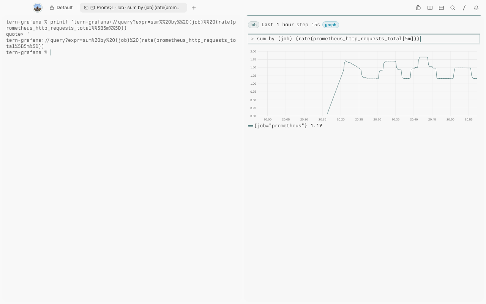 | 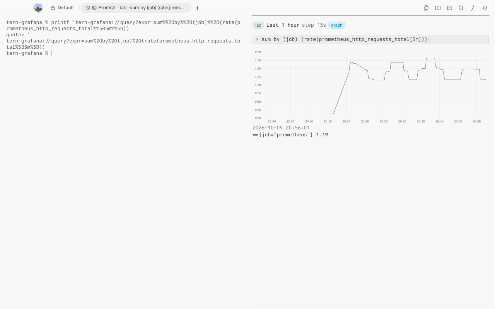 |

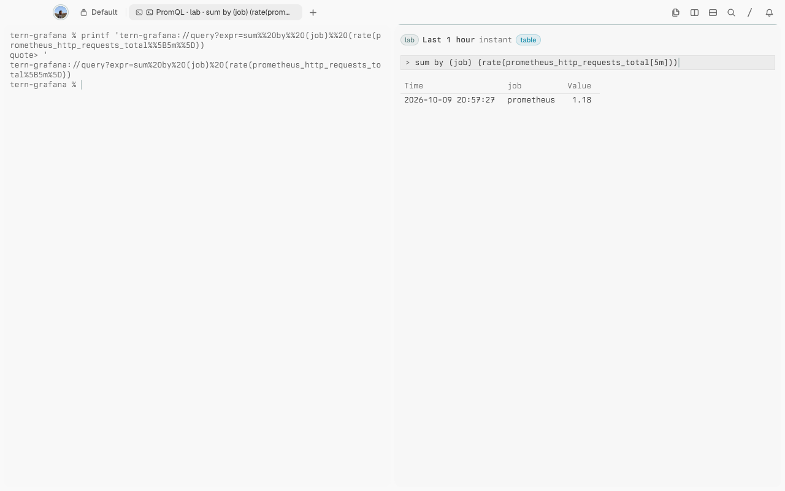

Any link opens it on a query:

```
tern-grafana://query?context=lab&expr=rate(node_cpu_seconds_total%5B5m%5D)&from=now-6h&to=now
```

| Keys | |
| --- | --- |
| `/` `i` | edit the query (suggestions: `tab` accepts, `ctrl+space` shows) |
| `g` `t` | graph (range query), table (instant query) |
| `left` `right` | move the cursor; with `shift`, ten samples |
| `[` `]` `-` `+` | shift the range, zoom out, zoom in |
| `1` .. `9` | last 5m, 15m, 1h, 3h, 6h, 12h, 24h, 2d, 7d |
| `r` `a` `c` | run again, auto-refresh, next context |
| `h` `y` `o` | history, copy, open in Grafana Explore |
| `I` `?` | investigate, help |

Details: [Query block](docs/query.md).

## Dashboards

**Grafana: Dashboard** searches the dashboards your Grafana user can see and
opens one with its rows, grid layout, variables (`v` opens the picker),
repeats, library panels, time range and auto-refresh. Each panel takes the
first rung of a ladder that works:

1. drawn natively: time series, stat, gauge, bar gauge, table, text, logs;
2. a PNG from Grafana's image renderer, when the server has one;
3. the reason, and `o` to open the panel in a Tern browser pane.

| Logs panel | Grafana-rendered PNG |
| --- | --- |
| 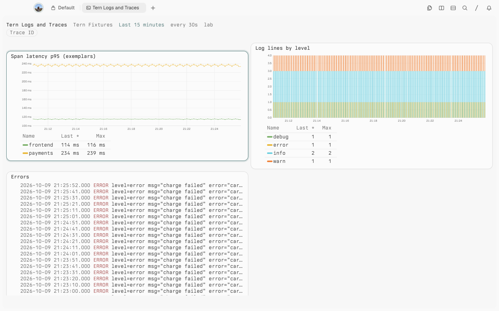 | 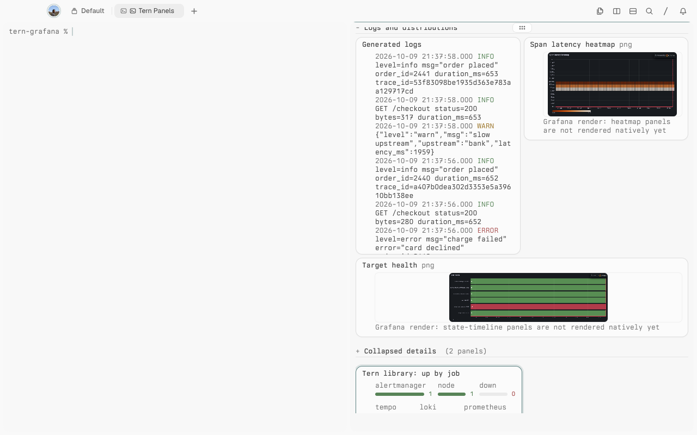 |

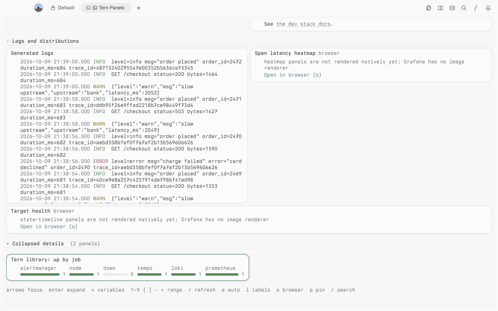

`p` pins the focused panel as its own Panel block with the same range keys
and cursor.

```
tern-grafana://dashboard?context=lab&uid=tern-variables&from=now-6h
```

| Keys | |
| --- | --- |
| arrows `tab` `shift+tab` | move between panels |
| `enter` `esc` | expand the focused panel, back |
| `1` .. `9` `[` `]` `-` `+` `0` | range keys; `0` is the dashboard's own range |
| `r` `a` | refresh now, pause or resume auto-refresh |
| `v` `/` | variable picker, open another dashboard |
| `o` `O` `y` | panel or dashboard in a browser pane, copy the Grafana URL |
| `p` `c` `C` | pin the panel, collapse its row, expand every row |
| `l` `I` | labels on a logs panel, investigate |

Details: [Dashboards](docs/dashboards.md).

## Alerts and silences

**Grafana: Alerts** opens the inbox: firing, pending and silenced alerts from
Grafana unified alerting, Alertmanager v2 or Prometheus, grouped by labels,
with runbook and dashboard links from annotations. A status-line segment shows
firing counts per polled context, toned by the worst severity; clicking it
opens the inbox. With `alerts.toasts` on, newly firing alerts raise a toast.

| Inbox | Rules (`v`) |
| --- | --- |
| 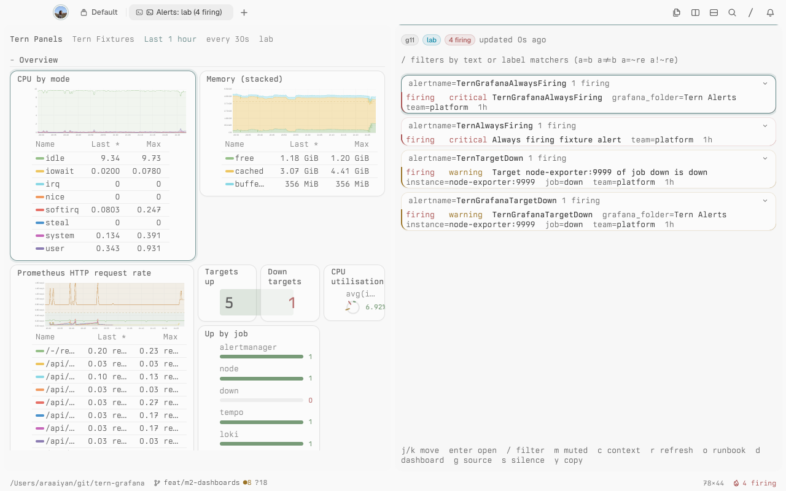 | 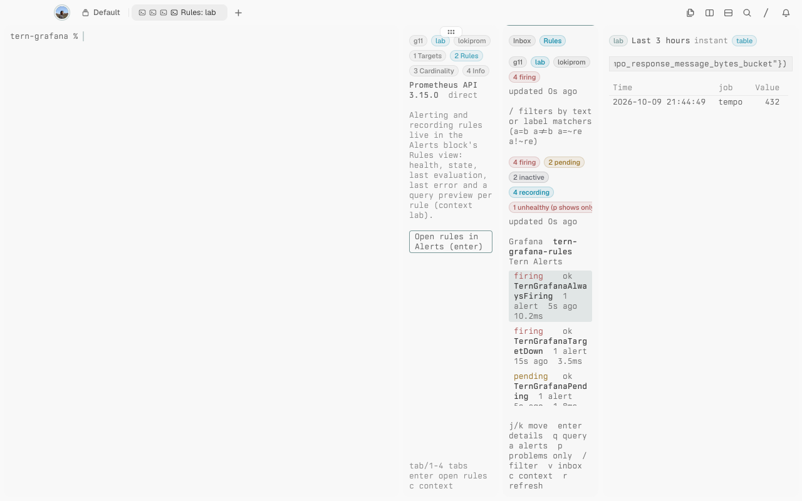 |

`s` on an alert (or **Grafana: Silences**) opens a silence prefilled with the
alert's matchers and previews the alerts it covers. A confirmation panel shows
matchers, times, comment, server and affected alerts; only `y` or **Confirm**
writes it. Expiring a silence is confirmed the same way.

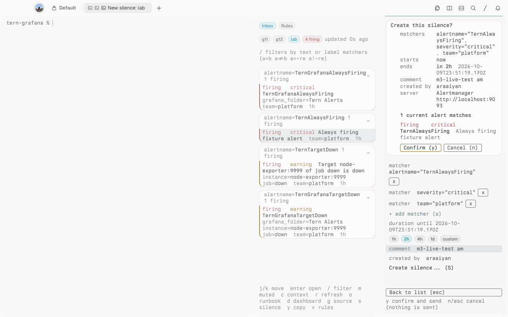

```json
"alerts": { "contexts": ["prod", "lab"], "poll_s": 60, "toasts": true }
```

| Keys (inbox) | |
| --- | --- |
| `j` `k` `enter` `space` | move, open a group or an alert |
| `/` `m` | filter, show silenced and inhibited |
| `o` `d` `g` | runbook, dashboard (native), source query or rule |
| `s` `y` `i` | silence, copy matchers, investigate |
| `v` `c` `C` `r` | rules view, next and previous context, refresh |

Details: [Alerts](docs/alerts.md).

## Logs

**Grafana: Logs** runs LogQL against Loki directly or through Grafana's Loki
datasource: lines newest first with a colored level, volume bars per level,
suggestions for labels, values and pipeline stages, and a polling tail (`t`).
A line's detail lists its stream labels, structured metadata and parsed
fields as chips; a click (or `f` / `x`) filters for or against that value.

| Lines and volume | Line detail |
| --- | --- |
| 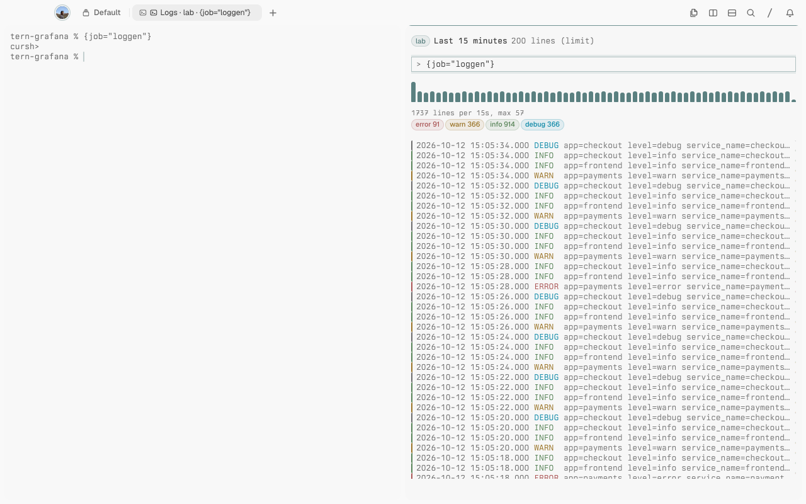 | 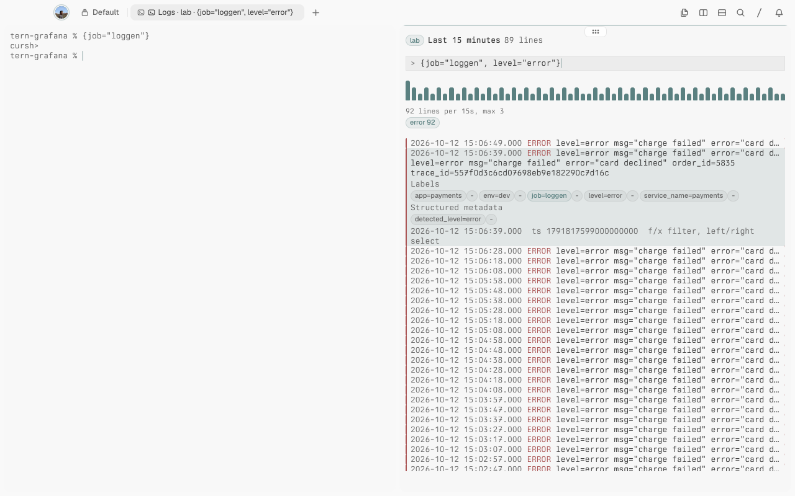 |

```
tern-grafana://logs?context=lab&expr=%7Bjob%3D%22loggen%22%7D&from=now-15m
```

| Keys | |
| --- | --- |
| `/` `i` `enter` | edit, open a line's detail |
| `f` `x` | filter for, filter out the selected chip |
| `t` `v` | tail, volume bars |
| `1` .. `9` `[` `]` `-` `+` | range keys |
| `r` `c` `y` `o` | run again, next context, copy the line, open in Explore |

Details: [Logs block](docs/logs.md).

## Ops

**Grafana: Ops** shows a Prometheus server's own health, directly or through
Grafana's datasource proxy: scrape targets (`u` unhealthy only, `d` dropped),
TSDB cardinality (top series, labels and pairs, each opening a breakdown
query), the rules view, and build, runtime, config and flags.

| Targets | Cardinality |
| --- | --- |
| 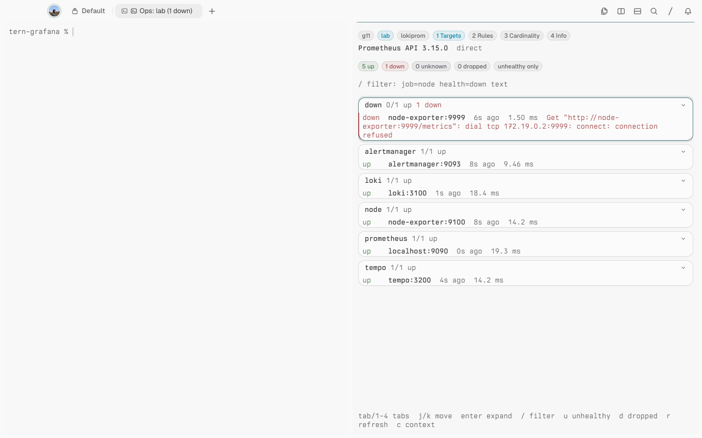 | 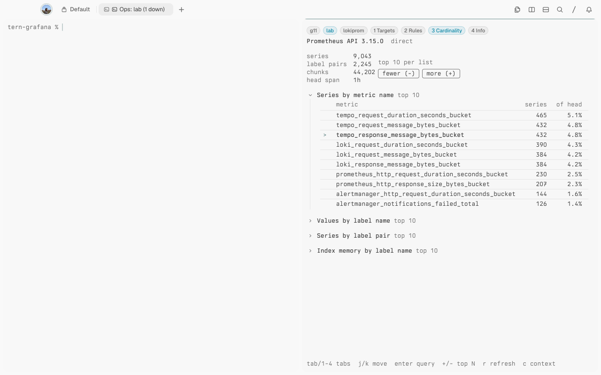 |

Details: [Ops](docs/ops.md).

## Command lenses

These commands render natively in the terminal; Tern's **Native/Raw** toggle
shows the original output. Pipelines and redirected output are never lensed.

| Command | You get |
| --- | --- |
| `promtool query instant\|range\|series\|labels ...` | series with sparks and a Graph/Table switch, or a table |
| `promtool check rules`, `promtool check config ...`, `promtool test rules ...` | pass or fail per file, with findings |
| `curl .../api/v1/query*` (Prometheus, Grafana datasource proxy, Loki), `curl .../api/ds/query` | series, a table, log lines or the error |
| `amtool alert ...`, `amtool silence ...` | alert and silence grids |
| `logcli query ...` | log lines with levels and labels, or metric results |

```sh
promtool query instant http://localhost:9090 up
```

| `promtool query` | `promtool check` |
| --- | --- |
| 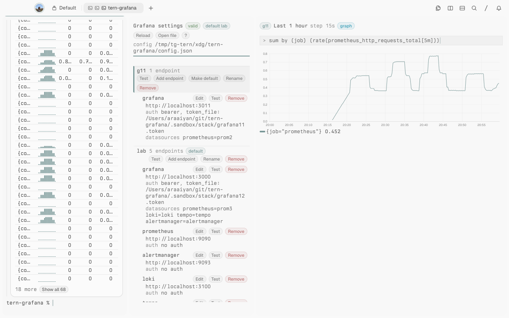 | 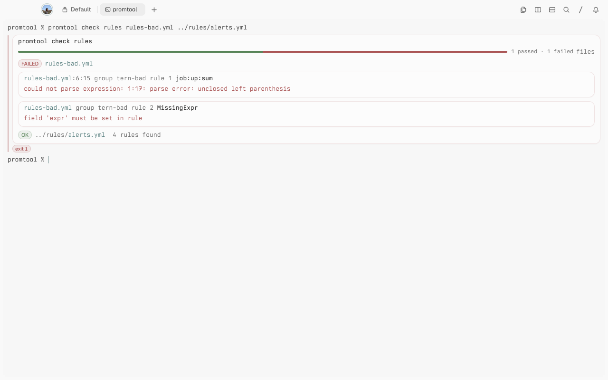 |

| `curl` | `amtool` |
| --- | --- |
| 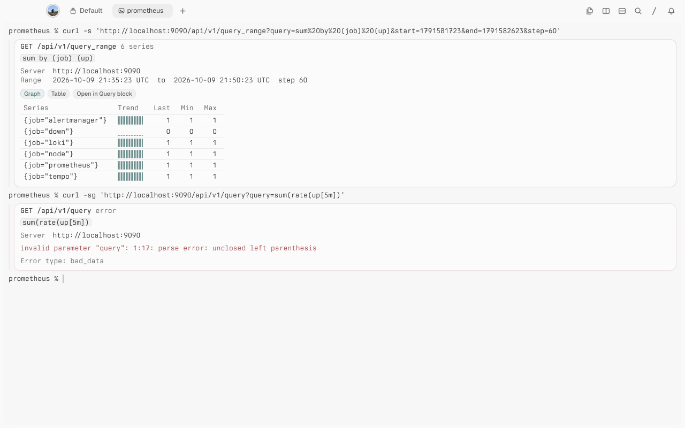 | 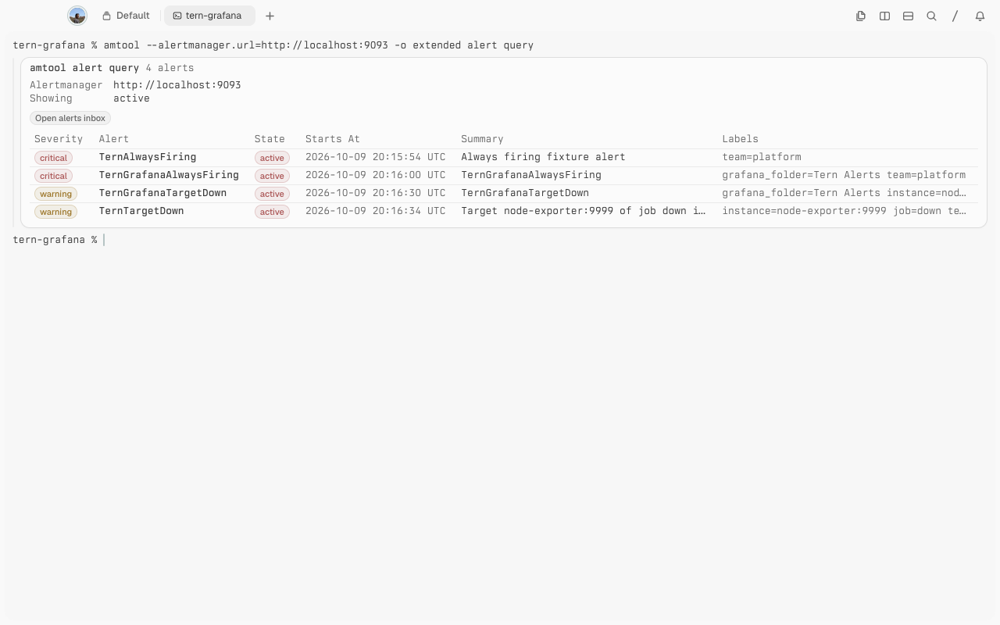 |

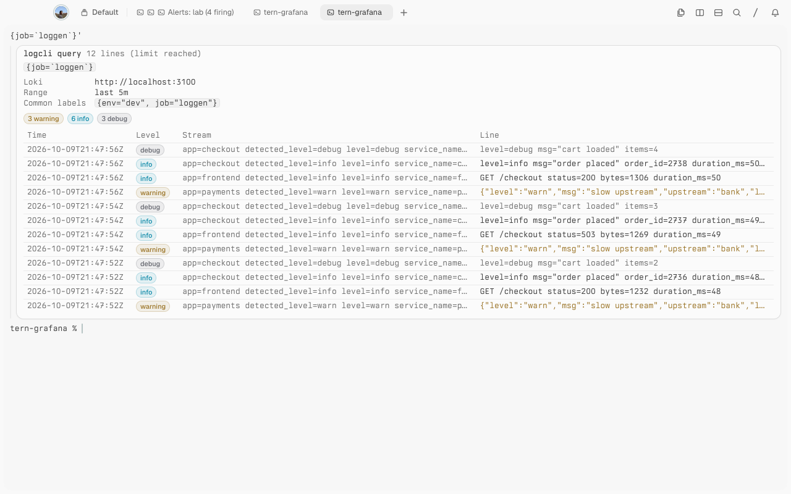

Details: [Lenses](docs/lenses.md).

## Deploy annotations and impact

Off until configured. When a command you run in Tern matches a deploy pattern
(`helm upgrade`, `kubectl apply`, `kubectl rollout restart`, `terraform apply`,
`argocd app sync`, `flux reconcile`, ...), Tern Grafana can:

- post a Grafana annotation with the command (secrets redacted), its duration,
  directory and git commit. The first time per context an approve block shows
  exactly what will be posted and asks **Always**, **Once** or **Never**;
- open an impact block comparing signals over the window before the command
  and after it: your configured queries, or request rate, 5xx ratio and p95
  latency guessed from the server's metric names.

| Approve | Posted |
| --- | --- |
| 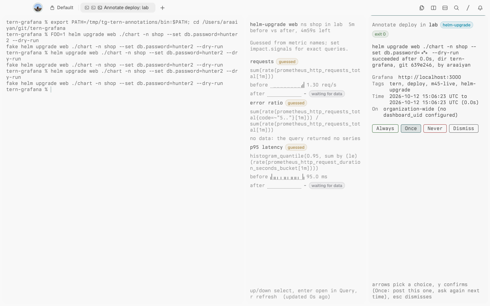 | 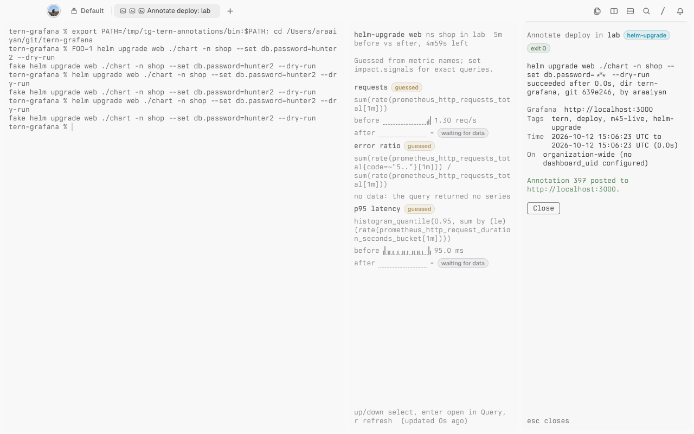 |

| Guessed signals | Configured signals |
| --- | --- |
| 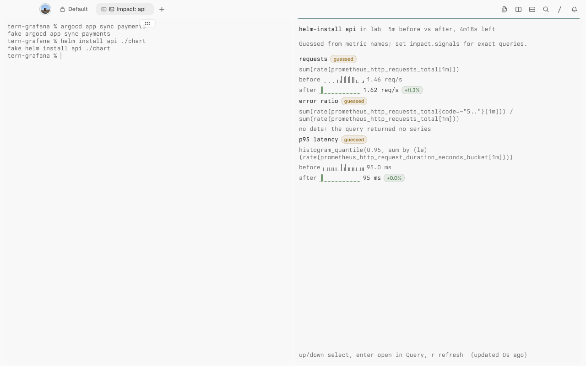 | 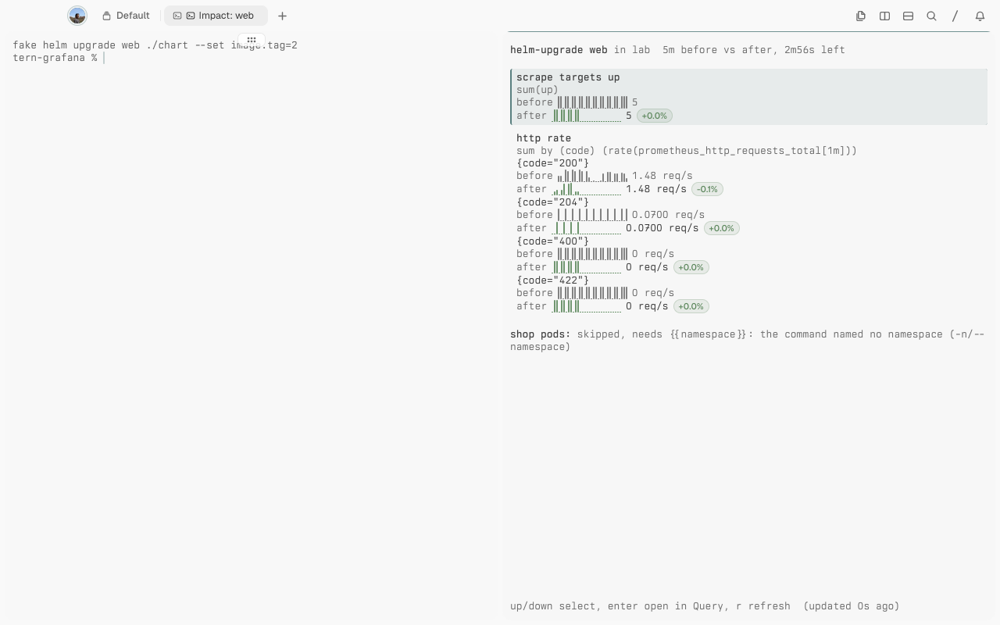 |

```json
"annotations": { "enabled": true, "context": "prod" },
"impact": { "enabled": true, "window": "15m" }
```

**Grafana: Deploy annotation decisions** lists remembered choices; `x`
forgets one. Details: [Deploy annotations and impact](docs/annotations.md).

## Carly and Investigate

Carly, Tern's assistant, gets four functions (`promql`, `alerts`,
`find_dashboard`, `logs`) that answer summaries, never raw samples or
credentials, plus a one-line firing summary with each question:

```lua
local r = await(plugins["tern-grafana"].promql("sum by (code) (rate(http_requests_total[$__rate_interval]))", "1h"))
return r.series[1]
```

**Investigate** (`i` on an alert, `I` in the Query block or on a dashboard
panel) opens a preview of the prompt: labels, queries, range, a summary of the
recent values and links back to Grafana. Tern's default agent starts only when
you press Send.

| Alert detail | Prompt preview |
| --- | --- |
| 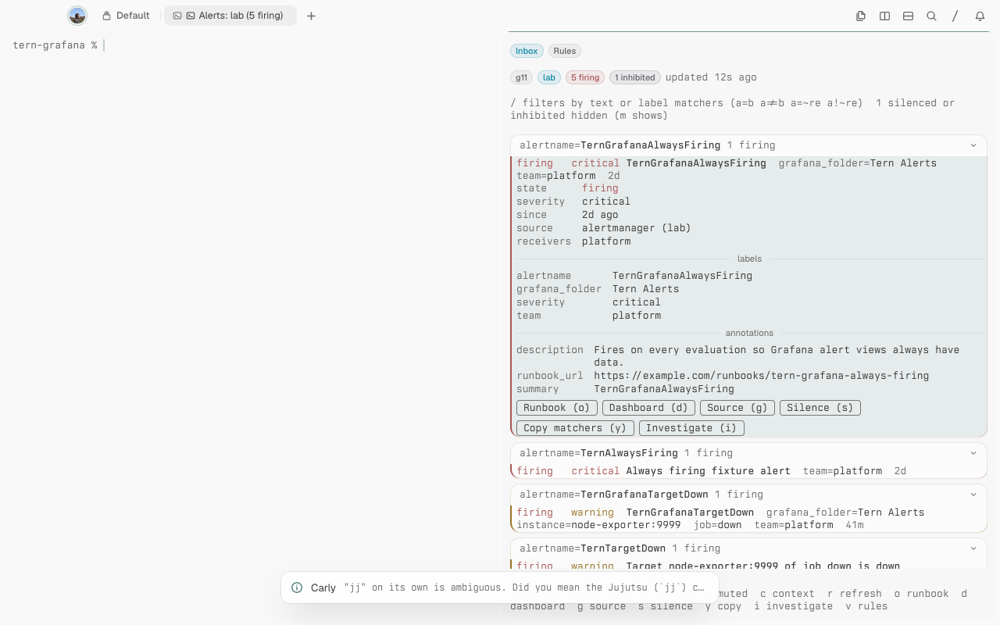 | 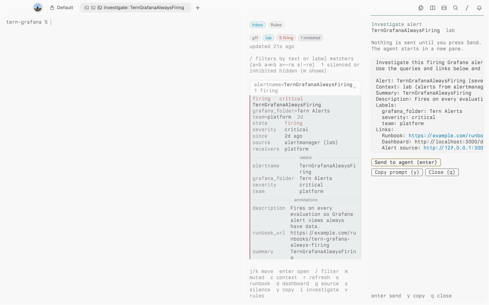 |

Details: [Carly](docs/carly.md), [Investigate](docs/investigate.md).

## Watches and per-host contexts

`watches` are personal PromQL alerts Tern evaluates itself, with `for` and a
severity: firing watches show in the status line and toast when they start
firing or resolve; **Grafana: Watches** opens the most urgent one's query.
`hosts` picks the default context per machine, so one config file serves a
laptop and remote hosts.

```json
"watches": [
  { "name": "api-errors", "context": "prod", "op": ">", "threshold": 0.05, "for": "5m", "severity": "critical",
    "expr": "sum(rate(http_requests_total{code=~\"5..\"}[5m])) / sum(rate(http_requests_total[5m]))" }
],
"hosts": { "*.prod.example.com": "prod", "ci-*": "staging" }
```

| Watch toast | Per-host default context |
| --- | --- |
| 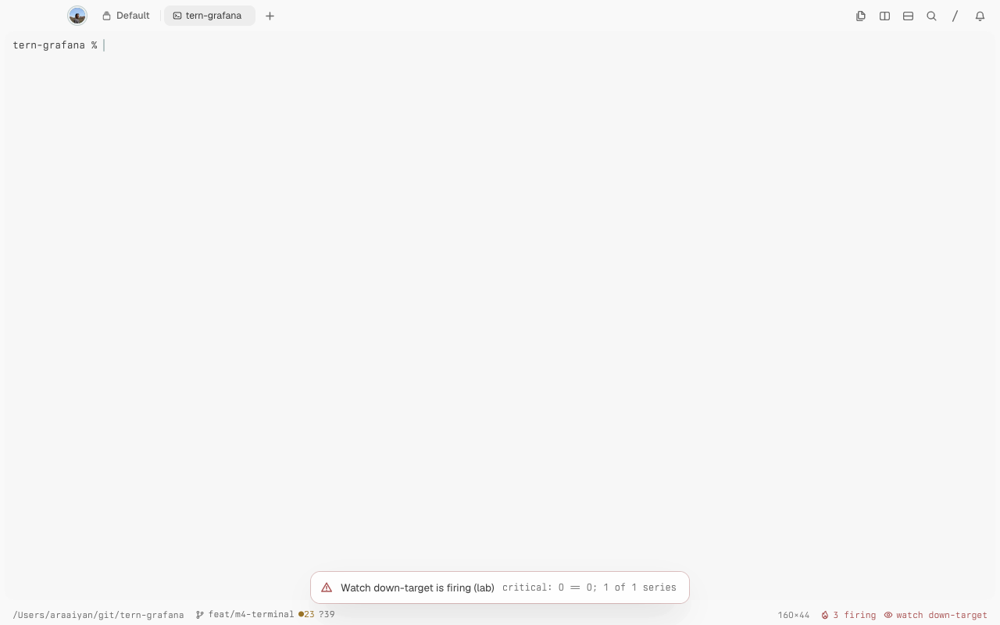 | 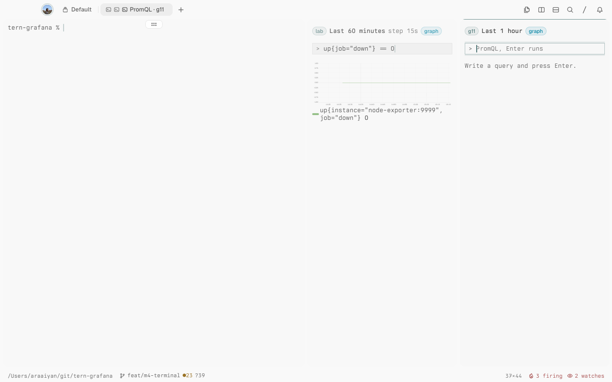 |

Details: [Threshold watches](docs/watches.md), [Per-host default contexts](docs/hosts.md).

## Grafana links

Links under a configured Grafana base URL open natively:

| Link | Opens |
| --- | --- |
| `/explore?...` (Prometheus or Loki datasource of the context) | Query or Logs block |
| `/d/<uid>/<slug>?from=...&var-x=...&viewPanel=<id>` | Dashboard block |
| `/d-solo/<uid>/<slug>?panelId=<id>` | Panel block |
| alert list and alert rule pages | Alerts inbox |
| anything else | Tern browser pane |

Plugin links (`tern-grafana://query`, `dashboard`, `panel`, `logs`,
`alerts?view=rules`) work from any terminal output or note. Links never carry
credentials.

## Install

```sh
tern plugin install github.com/contrafy/tern-grafana
```

For development, load a checkout in place (reloads on save):

```sh
tern plugin link /path/to/tern-grafana
```

Configure contexts in `~/.config/tern-grafana/config.json`
(`$XDG_CONFIG_HOME/tern-grafana/config.json` when set), or with
**Grafana: Settings** in the palette, which edits it safely and tests each
endpoint. The whole file is validated and every problem reported with its
JSON path ([configuration](docs/configuration.md), [Settings block](docs/settings.md)).

```json
{
  "default_context": "lab",
  "contexts": {
    "lab": {
      "grafana": {
        "url": "http://localhost:3000",
        "auth": { "type": "bearer", "token_cmd": ["op", "read", "op://vault/grafana/token"] },
        "datasources": { "prometheus": "prom3", "loki": "loki" }
      },
      "prometheus": { "url": "http://localhost:9090" }
    }
  }
}
```

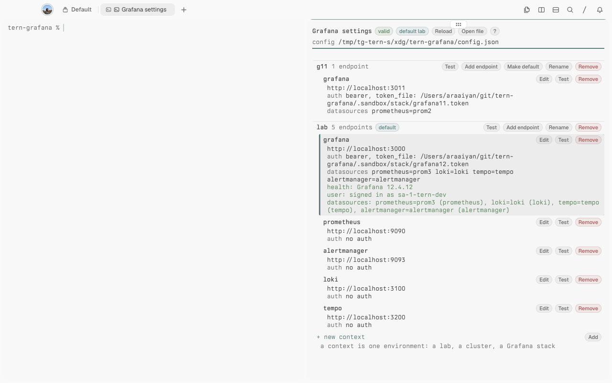

Tested with Tern 0.7.0 on macOS; Tern on Linux and remote hosts is not
verified yet (see [Features](#features)).

To remove: `tern plugin remove tern-grafana`.

## Credentials

Each endpoint resolves its credential at request time from one of:

- `token_cmd`: an argv run without a shell, for example
  `["op", "read", "op://vault/grafana/token"]` or
  `["security", "find-generic-password", "-s", "grafana", "-w"]`;
- an environment variable;
- a file readable only by you (mode `0600`).

Auth is bearer, basic, or none, plus extra headers such as `X-Scope-OrgID`.
Custom CAs, mutual TLS and insecure TLS go through `curl`. A literal token or
password in the config is rejected. The plugin never writes a credential to
disk, Tern's key-value store, logs, block arguments or saved state, and only
talks to the URLs you configure. See [SECURITY.md](SECURITY.md).

## Compatibility

| Backend | Versions |
| --- | --- |
| Grafana | 11, 12 |
| Prometheus | 2.53 LTS, 3.x |
| Alertmanager | 0.27+ |
| Loki | 3.x |
| Tempo | 2.x |

Thanos, Mimir, Cortex and VictoriaMetrics work through the same Prometheus
HTTP API (`path_prefix` for Mimir, tenant headers such as `X-Scope-OrgID`).

## Features

v1.0 is when every row reads done. Release history: [CHANGELOG.md](CHANGELOG.md).

| Feature | Status |
| --- | --- |
| **Contexts and settings** | |
| One validated config: Grafana and direct endpoints per context | done |
| Credentials from `token_cmd`, env or `0600` file; bearer, basic, headers | done |
| Custom CA, mutual TLS, insecure TLS via `curl` | done |
| **Grafana: Settings**: edit safely, test each endpoint | done |
| Per-host default context (`hosts`) | done |
| **Query** | |
| PromQL input with metric, label and value autocomplete | done |
| Native graph with keyboard cursor and legend read-out; table view | done |
| Range keys, auto-refresh, history, open in Explore | done |
| Grafana units, value formatting, thresholds as tones | done |
| **Dashboards** | |
| Search and open; grid layout, rows, repeats, library panels | done |
| Variables with picker; time range, auto-refresh | done |
| Native time series, stat, gauge, bar gauge, table, text, logs | done |
| Grafana image renderer PNG, then browser pane, per panel | done |
| Pin a panel as its own block | done |
| Native heatmap, state timeline and trace panels | planned |
| **Alerts and silences** | |
| Inbox: Grafana unified alerting, Alertmanager v2, Prometheus | done |
| Status-line firing counts; opt-in toasts | done |
| Alerting and recording rules with health and last error | done |
| Create silence with preview and confirm; list, expire | done |
| **Logs and traces** | |
| Loki logs: LogQL suggestions, level colors, volume bars, tail | done |
| Label, metadata and parsed-field chips that filter the query | done |
| Tempo trace waterfall and TraceQL search | planned |
| Exemplars to traces | planned |
| Jump between logs and metrics | planned |
| Shared time range and cursor across blocks | planned |
| **Ops** | |
| Targets, cardinality, build/runtime/config/flags; direct or via Grafana | done |
| **Command lenses** | |
| `promtool query` | done |
| `promtool check rules\|config`, `promtool test rules` | done |
| `curl` against `/api/v1/query*` and `/api/ds/query` | done |
| `amtool alert\|silence`, `logcli query` | done |
| **Terminal workflow** | |
| Grafana links open native blocks; browser pane otherwise | done |
| Deploy annotations: approve Always/Once/Never per context | done |
| Deploy impact: configured or guessed signals, before and after | done |
| Personal PromQL threshold watches | done |
| Carly exports and firing summary | done |
| Investigate with a prompt preview | done |
| **Platform** | |
| Tern on macOS | done |
| Tern on Linux | planned |
| Remote SSH hosts | planned |
| Tagged release v0.1.0 | planned |

| Backend | Query | Dashboards | Alerts | Silences | Ops | Logs | Traces | Lenses |
| --- | --- | --- | --- | --- | --- | --- | --- | --- |
| Prometheus direct | done | - | done | - | done | - | - | done |
| Grafana (Prometheus datasource) | done | done | done | - | done | - | - | done |
| Alertmanager | - | - | done | done | - | - | - | done |
| Grafana-managed alerting | - | - | done | done | - | - | - | - |
| Loki (direct or via Grafana) | - | done | - | - | - | done | - | done |
| Tempo (direct or via Grafana) | - | planned | - | - | - | - | planned | - |

`-`: not applicable. Prometheus-compatible servers (Thanos, Mimir, Cortex,
VictoriaMetrics) follow the Prometheus direct row. Lenses: `promtool` and
`curl` for Prometheus, `amtool` for Alertmanager, `logcli` and `curl` for Loki.

## Development

```sh
make bootstrap          # pinned luau, luau-lsp, StyLua, selene into .tools/
make check              # format check, lint, typecheck, unit tests
make stack-up           # Grafana 11 and 12, Prometheus 2.53 and 3, Alertmanager, Loki, Tempo in Docker
make fixtures-capture   # record test fixtures from the running stack
scripts/dev-tern.sh     # a sandboxed Tern under /tmp, never your own config
tern plugin link .      # load the checkout in place; reloads on save
```

More: [architecture](docs/architecture.md), [dev stack](docs/dev-stack.md),
[SDK capability matrix](docs/sdk-capability-matrix.md),
[contributing](CONTRIBUTING.md), [security](SECURITY.md), [support](SUPPORT.md).

## License

[MIT](LICENSE)
